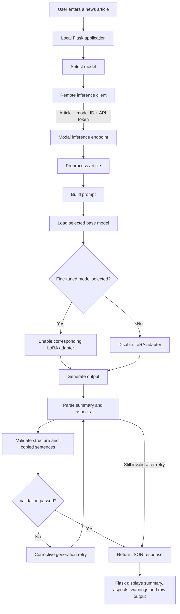

## Application Workflow

The Flask application does not load the OPT models on the user’s laptop. Model inference runs on a central Modal GPU service.



The Hugging Face repository stores only the fine-tuned LoRA adapters. Modal downloads the original OPT weights from Meta and combines the selected base model with its corresponding adapter during inference.

Supported model IDs:

| Model ID | Display name | Base model | Adapter |
|---|---|---|---|
| `opt125m_news` | Original OPT-125M | `facebook/opt-125m` | Disabled |
| `opt125m_news` | Fine-tuned OPT-125M | `facebook/opt-125m` | `opt-125m` |
| `opt13b_base` | Original OPT-1.3B | `facebook/opt-1.3b` | Disabled |
| `opt13b_news` | Fine-tuned OPT-1.3B | `facebook/opt-1.3b` | `opt-1.3b` |
| `opt27b_base` | Original OPT-2.7B | `facebook/opt-2.7b` | Disabled |
| `opt27b_news` | Fine-tuned OPT-2.7B | `facebook/opt-2.7b` | `opt-2.7b` |

## Teammate Setup

A teammate does not need to download the model or have a local GPU.

### 1. Download dependencies

```powershell
pip install -r requirements.txt
```

### 2. Create the local environment file

Create `.env` file and configure:
```env
NEWS_INFERENCE_API_URL=https://weihe6625--news-simplification-inference-newsinference-generate.modal.run
NEWS_INFERENCE_API_TOKEN=5STKnig1lCwAUag3R34RlnD6uroqRHeO
```

The actual API token must not be committed to GitHub.

### 3. Start the Flask application

```powershell
flask run
```

Open the application at:

```text
http://127.0.0.1:5000
```

## Request and Response Flow

The Flask application sends the following information to Modal:

```json
{
  "model": "opt27b_news",
  "article": "The news article entered by the user."
}
```

Modal returns a response containing:

```json
{
  "success": true,
  "model": "Fine-tuned OPT-2.7B",
  "summary": "Generated simplified summary",
  "aspects": {
    "event": "Extracted event",
    "people": "Extracted people",
    "organization": "Extracted organization",
    "date_time": "Extracted date and time",
    "location": "Extracted location",
    "causes": "Extracted causes",
    "effects": "Extracted effects",
    "countermeasures": "Extracted countermeasures"
  },
  "result": "Complete raw model output",
  "warning": null,
  "retry_used": false
}
```

The Flask interface displays the parsed summary, extracted aspects, quality warning, and complete raw model output.